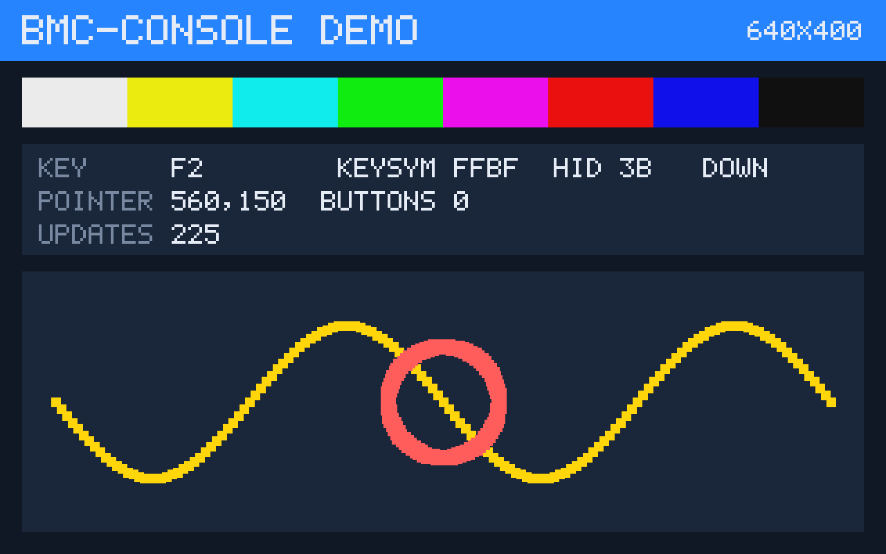

# bmc-console

Open the graphical console of a server's management controller (HPE iLO, Dell
iDRAC, legacy Supermicro ATEN) in a VNC viewer or in Apache Guacamole, without
Java applets or vendor clients.

`bmc-console` is a Go module plus two commands. `bmc-vnc` logs in to one BMC,
opens its remote console and serves it as a standard VNC server. `bmc-broker`
serves many BMCs to Guacamole on demand, with one-time session tickets. You can
also import the packages underneath and build your own console tooling.

> **Status: prototype.** The protocol code passes its tests against synthetic
> controllers, and video works on a real HPE iLO 5. Keyboard and mouse input on
> real hardware, and most firmware variants, have not been tried yet (see
> [Hardware support](#hardware-support)). APIs may change before the first
> tagged release.

## Quick start

Requires Go 1.27 or later. The module has no external dependencies.

```sh
go install github.com/dateo/bmc-console/cmd/bmc-vnc@latest
bmc-vnc -mode demo
```

Connect a VNC viewer to `127.0.0.1::5901` (display `:1`). The demo shows a test
screen. Each key event appears with its X11 keysym and the USB HID usage a BMC
would receive, and moving the pointer over the lower area draws on it (red while
a button is held). Each new connection starts with a clean screen.



### Connect a BMC

Set the BMC credentials, plus a separate 8-character VNC password that viewers
will use:

```bash
export BMC_USER=console-operator
read -rsp 'BMC password: ' BMC_PASSWORD; echo
read -rsp 'VNC password (8 ASCII characters): ' VNC_PASSWORD; echo
export BMC_PASSWORD VNC_PASSWORD
bmc-vnc -mode bmc -host ilo.example.net
```

The BMC account needs remote-console privileges and, where the vendor requires
one, the appropriate license.

| Flag | Default | Meaning |
|---|---|---|
| `-mode` | `demo` | `demo`, `bmc` (HPE iLO / Dell iDRAC, detected automatically) or `aten` (legacy Supermicro) |
| `-host` | | BMC hostname or address |
| `-listen` | `127.0.0.1:5901` | Loopback address for the viewer. Non-loopback addresses are refused. |
| `-insecure-bmc-tls` | `false` | Skip BMC HTTPS certificate verification. For isolated labs only. |
| `-allow-plain-aten` | `false` | Allow the unencrypted Supermicro ATEN KVM socket. |

The bridge serves one viewer at a time. It opens the BMC session when a viewer
authenticates and closes it when the viewer disconnects.

## Apache Guacamole

Run `bmc-vnc` in guacd's network namespace (a sidecar container, or
`network_mode: service:guacd` in Compose) and create a Guacamole VNC
connection to `127.0.0.1:5901` with the bridge's VNC password.

The full guide is in [docs/guacamole.md](docs/guacamole.md). It has a Docker
Compose stack you can start as is, a Kubernetes sidecar example, the
connection parameters, TLS setup, security notes and a troubleshooting table.

### Many BMCs: bmc-broker

If an application should open consoles on demand, run `bmc-broker` beside guacd
instead. The application requests a ticket with the BMC address and
credentials, gets a one-time VNC password back and hands Guacamole a VNC
connection with it. BMC credentials never reach Guacamole's database, and one
broker serves any number of BMCs in the networks you allow. See
[docs/broker.md](docs/broker.md) for the API and deployment.

## Container image

```sh
docker build -t bmc-console .                    # bmc-vnc
docker build -t bmc-broker --target broker .     # bmc-broker
docker run --rm --network container:<guacd-container> \
  -e BMC_USER -e BMC_PASSWORD -e VNC_PASSWORD \
  bmc-console -mode bmc -host ilo.example.net
```

Both images are based on `distroless/static`, run as non-root and carry the
license files under `/licenses`.

## Hardware support

| Target | Mode | Status |
|---|---|---|
| HPE iLO 4 | `bmc` | Legacy JSON console settings, session cookie, V1 keyboard/video and command channels. Tested against a local TLS controller fixture. **Not yet tested on hardware.** |
| HPE iLO 5/6/7 | `bmc` | Newer iLO console protocol (v2). **Verified on ProLiant DL360 Gen10, iLO 5 v3.20:** login, video, resolution change and reconnect. Keyboard and mouse input pending. Upstream reports testing on Gen10/10 Plus, Gen11 and Gen12. |
| Dell iDRAC9 | `bmc` | Detected through Redfish; opens the iDRAC web-console session. Upstream reports testing on an R750. If the iDRAC already offers native VNC, guacd can connect to it directly. |
| Supermicro, legacy ATEN (Hermon) | `aten` | HTTPS CGI login, JNLP ticket, ATEN handshake, Hermon decoder, HID input. Upstream tested on X8DTL-6F (WPCM450, firmware 3.13). Requires `-allow-plain-aten`. ASPEED video and the encrypted KVM socket are not supported. |

If you try other models or firmware, please open an issue with the BMC model,
the firmware version and what worked: POST, firmware setup, modifier keys,
mouse buttons, resolution changes, reconnect.

### TLS

The bridge checks the BMC's HTTPS certificate against the system trust store.
For a private CA, add it to the trust store or point `SSL_CERT_FILE` /
`SSL_CERT_DIR` at it. `-insecure-bmc-tls` turns the check off; keep that to
isolated lab networks.

## Using the Go packages

```sh
go get github.com/dateo/bmc-console
```

`pkg/bridge` is the entry point. `bridge.Open` returns a `Backend` with frame
snapshots and keysym/pointer input. `bridge.ServeConn` serves one VNC viewer on
top of a `Backend`, and `bridge.Server` is the single-viewer accept loop that
`bmc-vnc` uses.

```go
import "github.com/dateo/bmc-console/pkg/bridge"

opts := bridge.Options{Mode: bridge.ModeBMC, Host: "ilo.example.net", Username: user, Password: pw}
srv := &bridge.Server{
	Password: vncPassword, // at most 8 bytes; empty disables VNC authentication
	Open:     func(ctx context.Context) (bridge.Backend, error) { return bridge.Open(ctx, opts) },
}
err := srv.Serve(ctx, listener)
```

To drive a console without VNC, call `bridge.Open` and use `Frame`, `Key` and
`Pointer` directly.

| Package | Contents |
|---|---|
| `pkg/bridge` | Backends (iLO/iDRAC, ATEN, demo) and the VNC server |
| `pkg/broker` | One-time session tickets, the ticket API and the multi-BMC VNC listener behind `bmc-broker` |
| `pkg/console` | Vendor-neutral HPE/Dell session: detection, frames, HID input, virtual media and power hooks |
| `pkg/ilo`, `pkg/idrac`, `pkg/bmc` | iLO and iDRAC login, Redfish detection, console transports |
| `pkg/kvm` | iLO console protocol: handshake, AES stream, video decoder, input reports |
| `pkg/aten` | Supermicro ATEN: CGI login, JNLP ticket, Hermon decoder, HID input |
| `pkg/rfb` | RFB client, keysym and pixel helpers |
| `pkg/vmedia`, `pkg/wsx`, `pkg/keyboardmap` | Virtual media, WebSocket transport, keyboard layout maps |

## VNC protocol scope

The server speaks RFB 3.3, 3.7 and 3.8 with classic VNC authentication. It
sends raw true-colour rectangles and DesktopSize updates, and accepts key
press/release, pointer position and buttons. For incremental updates it sends
one bounding rectangle around the changed pixels. Viewers without DesktopSize
support have to reconnect after a resolution change. The keyboard mapping
covers US printable keys, modifiers, arrows, function keys and the usual
firmware shortcuts.

The VNC side does not support other keyboard layouts, the clipboard, virtual
media, power control or more than one viewer at a time.

## Development

```sh
go build ./...
go test -race ./...
```

`tests/guacd_smoke.py` drives a real guacd against the demo bridge and needs
only the Python standard library. Run it in the same network namespace as guacd
and the bridge, with `VNC_PASSWORD` set to the bridge's password.

Live tests against real controllers are skipped unless their environment
variables are set (see `pkg/idrac/live_test.go` and `pkg/console/live_test.go`).

## Credits and license

bmc-console is licensed under the [Apache License 2.0](LICENSE).

It builds on two Apache-2.0 projects: the HPE and Dell console code comes from
[Firstlight](https://github.com/ThatIsCraZy/Firstlight) by Benjamin Dittmaier,
and the Supermicro ATEN code from
[ipmi-connect](https://github.com/mhamzahkhan/ipmi-connect) by M. Hamzah Khan.
See [NOTICE](NOTICE) and [THIRD_PARTY_NOTICES.md](THIRD_PARTY_NOTICES.md) for
upstream revisions, modifications and notices.

This project is not affiliated with or endorsed by HPE, Dell, Supermicro, ATEN
or the Apache Software Foundation. Their product names appear here only to say
what the software works with.
