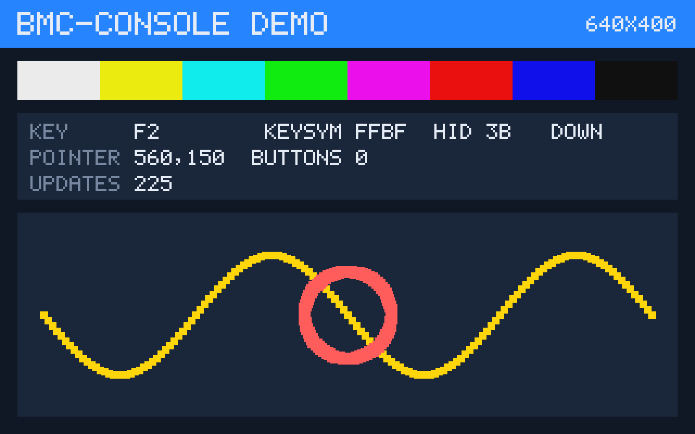

# Using bmc-console with Apache Guacamole

[Apache Guacamole](https://guacamole.apache.org/) is a remote desktop gateway
that runs in the browser. Its proxy daemon, guacd, speaks VNC, RDP and SSH, but
not the proprietary KVM protocols of server management controllers. `bmc-vnc`
sits in between: it logs in to one BMC, opens its graphical console and offers
it to guacd as an ordinary VNC server.

```
browser ──HTTPS──► Guacamole web app ──► guacd ──VNC, loopback──► bmc-vnc ──HTTPS/KVM──► BMC
                                         └──── same network namespace ────┘
```

## How it fits together

Each `bmc-vnc` process talks to one BMC and serves one viewer at a time. A
second viewer is turned away until the first disconnects. The bridge logs in to
the BMC and opens the console when guacd authenticates, and closes both when
guacd disconnects, so an idle bridge holds no BMC session.

The bridge only listens on loopback addresses, because classic VNC
authentication does not encrypt anything. Run it inside guacd's network
namespace, as a sidecar container in the guacd Pod or with
`network_mode: service:guacd` in Docker Compose. guacd then connects to
`127.0.0.1:<port>`.

Two credentials are involved. The BMC account (`BMC_USER`/`BMC_PASSWORD`) stays
with the bridge. Guacamole only knows the bridge's VNC password
(`VNC_PASSWORD`, exactly 8 ASCII characters in hardware mode), so users never
see the BMC password.

## Try it with Docker Compose

[`examples/guacamole`](../examples/guacamole) starts guacd, the bridge and the
Guacamole web app with file-based authentication. The bridge starts in demo
mode, so you don't need a BMC to try it:

```sh
cd examples/guacamole
cp example.env .env
docker compose up -d --build
```

Open <http://127.0.0.1:8080/guacamole/> and log in as `operator` / `change-me`
(from [`guacamole-home/user-mapping.xml`](../examples/guacamole/guacamole-home/user-mapping.xml)).
Guacamole opens the demo test screen. Press a key and the screen shows its
keysym and the USB HID usage a BMC would receive. Move the pointer over the
lower area to draw on it. That way you can check keyboard and mouse input through
the whole chain before you connect real hardware.



To connect real hardware, edit `.env`:

```sh
BMC_MODE=bmc                    # HPE iLO 4-7, Dell iDRAC9
BMC_HOST=ilo.example.net
BMC_USER=console-operator
BMC_PASSWORD=...
VNC_PASSWORD=8chars!!           # also set it in user-mapping.xml
```

Then run `docker compose up -d` again.

> **Note:** Docker Compose takes variables exported in your shell over the ones
> in `.env`. If `VNC_PASSWORD` or any `BMC_*` variable is set in your shell,
> unset it first, or the bridge gets that value instead.

## Guacamole connection settings

Create a connection with protocol VNC:

| Parameter | Value | Notes |
|---|---|---|
| `hostname` | `127.0.0.1` | As seen from guacd, which shares the bridge's network namespace. |
| `port` | the bridge's `-listen` port | Default `5901`. Use one port per bridge. |
| `password` | the bridge's `VNC_PASSWORD` | Leave the username empty. |
| `color-depth` | `24` (recommended) | 8, 16 and 32 work too. |
| `cursor` | `remote` | Most BMCs draw their own pointer. |
| `read-only` | `true` (optional) | For view-only access such as watching POST. |

The bridge sends raw rectangles only and supports DesktopSize, so guacd follows
resolution changes during boot (on one iLO 5, for example, the screen went from
800×600 to 1280×1024 once the OS console came up). Clipboard, audio, file
transfer and virtual media don't work through VNC.

With file authentication the connection looks like this:

```xml
<connection name="rack1-node1 console">
    <protocol>vnc</protocol>
    <param name="hostname">127.0.0.1</param>
    <param name="port">5901</param>
    <param name="password">8chars!!</param>
    <param name="color-depth">24</param>
    <param name="cursor">remote</param>
</connection>
```

With the database, LDAP or SSO extensions, enter the same values in
**Settings → Connections → New Connection**. With the
[JSON auth extension](https://guacamole.apache.org/doc/gug/json-auth.html), put
them in the `connections` object of the signed payload.

## Kubernetes

[`examples/kubernetes/guacd-with-bridge.yaml`](../examples/kubernetes/guacd-with-bridge.yaml)
adds one bridge container per BMC to the guacd Deployment, each on its own
loopback port, with credentials from a Secret.

The guacd Pod needs a route to the BMC management network. If your CNI supports
egress policies, allow traffic there and nowhere else. In the other direction,
restrict port 4822 to the Guacamole web app with a NetworkPolicy: anyone who
can reach guacd can ask it to open any configured console.

Keep `replicas: 1`. A bridge serves one viewer, and most BMCs only allow one
console session anyway. Adding a BMC means adding a container and redeploying
guacd, so for a large fleet you will want to generate the Deployment from your
inventory.

## TLS to the BMC

By default the bridge checks the BMC's HTTPS certificate against the system
trust store. Most BMCs ship with a self-signed certificate. In order of
preference:

1. Install a certificate from your own CA on the BMC.
2. Trust the BMC's CA in the container: mount it and set `SSL_CERT_FILE`
   (single file) or `SSL_CERT_DIR` (directory), which Go honours on Linux.
3. In an isolated lab only, add `-insecure-bmc-tls`. The bridge then can't tell
   whether it is talking to the real BMC.

Supermicro ATEN mode also needs `-allow-plain-aten`, because its KVM socket is
unencrypted. Use it only on a management network you trust.

## Security checklist

- Give the bridge a BMC account with remote console privileges rather than
  administrator rights, if the firmware lets you.
- Treat access to a BMC console like physical access. Through it, a user can
  enter firmware setup, change the boot order and watch secrets typed at boot.
- Inside guacd's namespace, the VNC password is all that protects a bridge.
  Use a random value for each one.
- Guacamole logs who opened which connection. For a record of what happened on
  the console itself, turn on
  [session recording](https://guacamole.apache.org/doc/gug/recording-playback.html).

## Troubleshooting

| Symptom | Cause |
|---|---|
| guacd: `Unable to connect to VNC server`, bridge: `viewer authentication failed` | The connection's VNC password does not match `VNC_PASSWORD`. |
| guacd: `Unable to connect to VNC server`, nothing in the bridge log | The bridge is not in guacd's network namespace, or the port is wrong. |
| bridge: `listen requires a numeric loopback address` | `-listen` must be like `127.0.0.1:5901`, not `0.0.0.0` or a hostname. |
| bridge: `hardware mode requires ... an 8-byte VNC_PASSWORD` | In `bmc` and `aten` mode the VNC password must be exactly 8 characters. |
| bridge: `iLO login failed: HTTP 403 ... JS_ERR_NO_PRIV` | Wrong BMC credentials, or the account lacks login or console privileges. Repeated failures can lock the account. |
| bridge: `x509: certificate signed by unknown authority` | See [TLS to the BMC](#tls-to-the-bmc). |
| Session closes when the BMC changes resolution | The VNC client lacks DesktopSize support. guacd supports it; reconnect other viewers. |
| Second user cannot connect | Expected. One viewer per bridge, and most BMCs allow one console session. |
